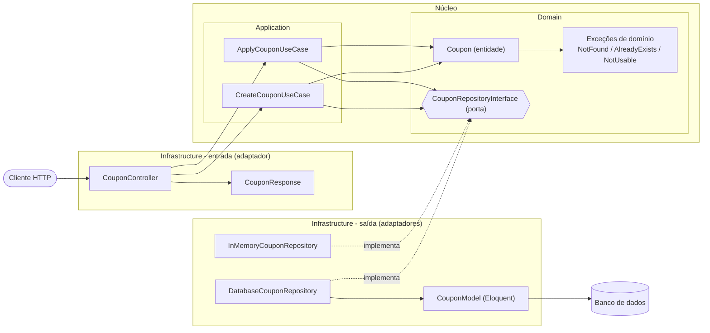
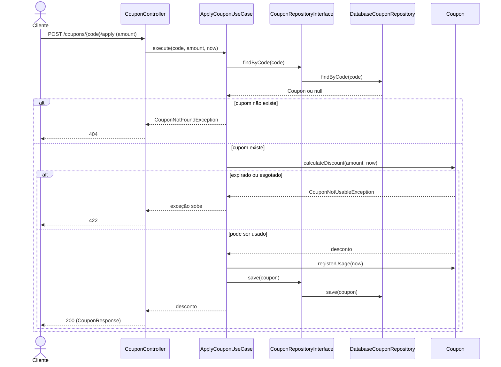

# Cupom Hexagonal

Projeto simples de **cupons de desconto**, criado com o objetivo de **aprender e praticar Arquitetura Hexagonal** (Ports and Adapters) usando Laravel.

> Este é um projeto de estudo. O foco não é ter muitas funcionalidades, e sim organizar o código de forma que as regras de negócio fiquem isoladas de frameworks, banco de dados e outros detalhes de infraestrutura.

## Objetivo

- Entender na prática os conceitos de **domínio**, **portas** (ports) e **adaptadores** (adapters).
- Manter as regras de negócio dos cupons independentes do Laravel e do banco de dados.
- Facilitar a troca de tecnologias (ex.: banco, HTTP, CLI) sem alterar o núcleo da aplicação.
- Escrever testes do domínio sem depender de infraestrutura.

## Arquitetura Hexagonal em resumo

```
          Adaptadores de entrada              Adaptadores de saída
        (HTTP, CLI, testes...)              (PostgreSQL, memória...)
                  │                                   ▲
                  ▼                                   │
          ┌──────────────┐                    ┌──────────────┐
          │ Portas de    │                    │ Portas de    │
          │ entrada      │                    │ saída        │
          └──────┬───────┘                    └──────▲───────┘
                 │                                   │
                 ▼                                   │
          ┌──────────────────────────────────────────┴──┐
          │        Aplicação (casos de uso)             │
          │                                             │
          │        Domínio (entidades e regras)         │
          └─────────────────────────────────────────────┘
```

- **Domínio**: entidades e regras de negócio do cupom (ex.: validade, valor do desconto, limite de uso).
- **Aplicação**: casos de uso que orquestram o domínio (ex.: criar cupom, aplicar cupom).
- **Portas**: interfaces que definem como o núcleo conversa com o mundo externo.
- **Adaptadores**: implementações concretas das portas (controllers, repositórios Eloquent, etc.).

## Diagramas

Os diagramas abaixo mostram a arquitetura planejada. Nem todas as classes existem ainda (veja `BACKEND_TODO.md`).

### Arquitetura (camadas, portas e adaptadores)



A regra de dependência é que as setas sempre apontam para o núcleo. O `Domain` não importa nada de fora, e a `Infrastructure` implementa as portas.

### Fluxo de `POST /coupons/{code}/apply`



## Stack

- PHP / Laravel
- PostgreSQL
- Nginx
- Docker Compose

## Como rodar

```sh
docker compose up -d --build
```

A aplicação ficará disponível em [http://localhost:8000](http://localhost:8000) (porta configurável via `APP_PORT`).
